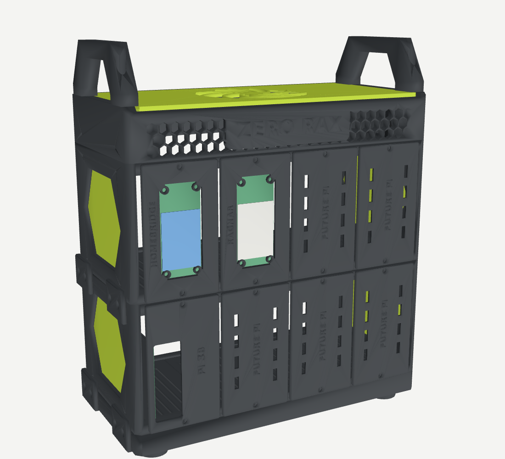
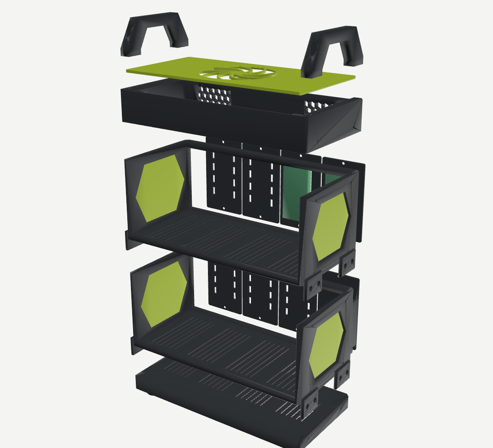

# Zero Rax: a stackable mini rack for Pi Zeros and full-size Pis



A desktop rack in the Lab Rax style: black chamfered frame, lime panels, a hex-mesh front band with raised lettering, big handles and a swirl fan grille. It's built from stacked layers:

| Layer | Holds |
|---|---|
| **Cap** | "ZERO RAX" hex band, 2 handles, a 92 mm exhaust fan under a lime swirl grille |
| **Zero tier** | 4 Pi Zero cassettes: Homebridge display (Whisplay) and Ragnar (2.13" e-ink), plus 2 blanks |
| **Pi tier** | 4 full-size Pi blades (Pi 3B / 4 / 5): the Pi 3B now, plus 3 blanks (swap one for `blade_pi5` later) |
| **Base** | Lab Rax style feet, vents |

Both tiers are the **same part**, printed twice, so you can add a third tier later. Size: **244 wide × 118 deep × about 280 mm tall** with the handles.



## Files

- `zero_rax_black_plate1–4.3mf` and `zero_rax_lime_plate1–2.3mf`: ready-to-slice plates for the P2S, every part already rotated to its print orientation.
- `stl/`: each part on its own, also in print orientation.
- `make_rack.py`: generates everything. All measurements are at the top of the file.

| Part | Qty | Colour | Notes |
|---|---|---|---|
| `tier` | 2 | black | Printed standing on its front face. Tallest print (118 mm). |
| `base` | 1 | black | Printed upside down (feet up). |
| `cap` | 1 | black | Printed right side up. The raised "ZERO RAX" letters can be painted lime. |
| `handle` | 2 | black | Printed on its side. |
| `clip` | 12 | black | Join the layers on the outside of the side walls. |
| `dowel` | 12 | black | Line up the layers. A 3 mm steel pin or a piece of 3 mm filament also works. |
| `cassette_homebridge`, `cassette_ragnar` | 1 each | black | Face plates for the two Pi Zeros. |
| `blade_pi3b` | 1 | black | Face plate and sled for the Pi 3B. `blade_pi5` is the same part with a "PI 5" label. |
| `blank_future_pi` | 5 | black | Covers for the empty slots. |
| `zero_spacer` | 8 | black | 11 mm spacers between each Pi Zero and its HAT. |
| `cap_panel` | 1 | lime | Top panel with the swirl fan grille. |
| `side_insert` | 4 | lime | Press into the hexagon windows from the inside. |

**Print settings:** PLA or PETG, 0.2 mm layers, 3 walls, 15–20% infill. No supports are needed. The only bridge is the top of the Pi 3B's port window (about 58 mm), which the P2S handles fine.

**Lime letters (optional):** the cassette and blank plates print face-up, with the raised labels on top. In Bambu Studio, add a filament change at the layer where the letters start (3.3 mm total height, letters are the top 0.8 mm) to print the labels in lime.

## Hardware

| Item | Qty | Used for |
|---|---|---|
| M3 × 8 flat-head (countersunk) screws | 44 | 16 for the face plates (2 per slot), 24 for the clips, 4 for the top panel |
| M3 × 12 screws | 4 | Handles |
| M2.5 × 20 flat-head screws + M2.5 nuts | 8 + 8 | The two Pi Zero stacks (4 each) |
| M2.5 × 6 screws | 4 | Pi 3B onto its blade |
| 92 mm 5 V fan (25 mm or slim 14 mm) | 1 | Cap exhaust fan. Its own screws go through the grille. Power it from a Pi's 5 V and GND pins or a USB fan cable. |
| Rubber pads, Ø10 mm | 4 | Optional, in the recesses under the feet |

All M3 screws cut their own threads in the plastic. Drive them in slowly the first time.

## Assembly

1. **Base and tiers:** put 2 dowels in each side of the base, set the Pi tier on top, then the Zero tier, then the cap, with dowels between each layer. Screw a clip across each joint on both sides, front and back (12 clips in total).
2. **Side panels:** press the lime inserts into the hexagon windows from the inside.
3. **Pi Zero cassettes:** lay the HAT screen-down against the back of its face plate. Push the four M2.5 × 20 screws in from the front, through the HAT, an 11 mm spacer, and the Pi Zero, and fit a nut at the back. Put a microSD card in first.
4. **Pi 3B blade:** screw the Pi 3B onto the four standoffs, with its USB and Ethernet at the front window.
5. Slide each module into its slot and fix it with 2 M3 screws, top and bottom. The blade's sled runs in the groove in the floor. Fill the empty slots with blanks.
6. **Fan and cap:** screw the fan under the lime panel, blowing up and out. Put the panel into the cap and fix it with 4 M3 screws, then screw the handles on.

**Cables:** everything leaves through the open back. On the Pi Zeros, the micro-USB ports face the 27 mm gap beside each Pi, which is room enough for straight plugs. On the Pi 3B, power and HDMI plug into the top edge, and there's about 30 mm of room above it for the plugs.

## Check before printing everything

- **Header gap:** the Pi Zero stacks assume an **11 mm gap** between the Pi Zero and its HAT, which is standard headers. If yours differs, change `HAT_GAP` and rebuild the spacers.
- **Test fit:** print one `cassette_homebridge` first (about 20 minutes) and mount the Homebridge Pi on it. The window is the full board size with small pads at the four corner holes, so it doesn't depend on exactly where the screen, button or LED sit on the Whisplay.

## Changing the design

Edit the measurements at the top of `make_rack.py`, then:

```bash
pip install manifold3d trimesh numpy networkx lxml matplotlib
python3 make_rack.py          # STLs and 3MF plates
python3 render_rack.py        # quick preview image
```

To change the labels, edit the `PARTS` table at the bottom. For example, `lambda: cassette("PI-HOLE")` makes a new cassette, and `lambda: blade("PI 5")` a new blade.
